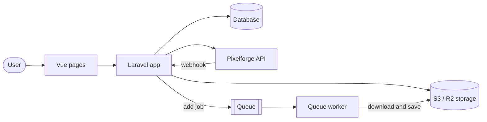
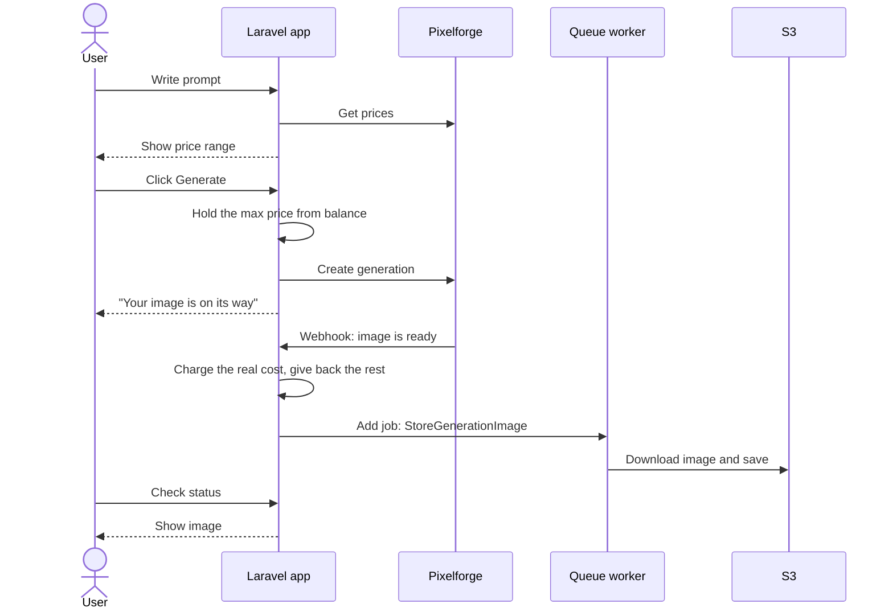
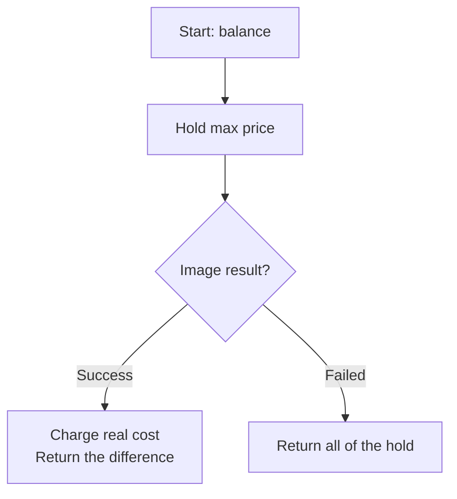
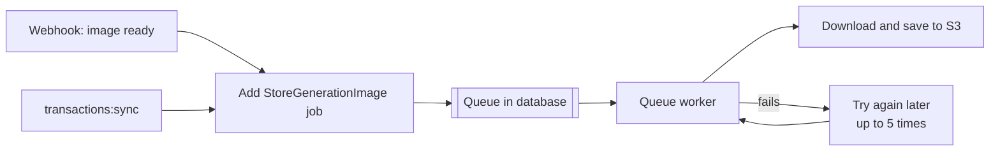
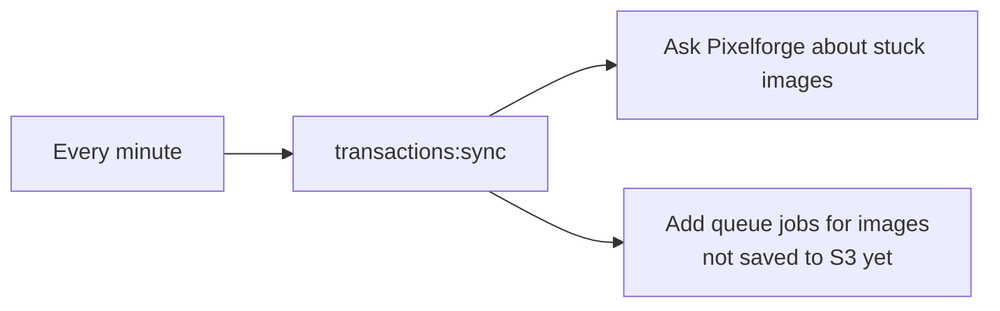

# Pixelgen

Pixelgen is a web app that makes images from text.

You write a prompt, pick a size and quality, and Pixelgen asks **Pixelforge** (an image API) to draw it. You pay for each image from your balance.

Built with **Laravel 13**, **Inertia v3** and **Vue**.

## What it can do

- Show the price range before you make an image
- Make an image from a prompt, with optional reference images
- Show live status while the image is being made
- Save finished images in your own S3 bucket
- Download or delete your images
- Keep a balance and a billing history
- Admin pages for reports and webhook logs

## Architecture

### The big picture



- **Vue pages** are the screens the user sees.
- **Laravel app** handles all the logic.
- **Queue** keeps slow work to do later, so the app can answer fast.
- **Queue worker** takes jobs from the queue and runs them.
- **Database** keeps users, balances and generations. It also stores the queue jobs.
- **Pixelforge** makes the images.
- **S3** keeps the finished images and reference images.

### How one image is made



### How money works

We **hold** the highest possible price first. When the image is done, we charge the **real** cost and give back the rest. If the image fails, we give back everything.



- All money uses `bcmath` strings, never floats.
- The price includes a markup (`MARKUP_MARGIN`, in percent).
- Each user can only make one image at a time.

### The queue

Downloading an image and saving it to S3 can be slow. So the app does not do it while answering the webhook. It adds a job to the queue, and the queue worker does it later.



- The queue uses the database (`QUEUE_CONNECTION=database`).
- Each image has only one job at a time, so it is never saved twice.
- The job downloads the image from the link the webhook gave us. It does not call the Pixelforge API.
- Only if that link has expired does the job ask the Pixelforge API for a new one.
- If the job fails, it tries again after 10s, 30s, 2m, 10m and 30m.
- If the worker is not running, images stay "succeeded" but are not saved to S3.

### Backup when a webhook is missed

Sometimes a webhook does not arrive. A scheduled command runs every minute to fix this.



### Main parts of the code

| Part | File | What it does |
| --- | --- | --- |
| Generations | `app/Http/Controllers/GenerationController.php` | Estimate, create, show, download and delete images |
| Webhook | `app/Http/Controllers/PixelforgeWebhookController.php` | Receives updates from Pixelforge |
| Billing | `app/Http/Controllers/BillingController.php` | Balance, history and credit packs |
| Pixelforge API | `app/Services/PixelforgeService.php` | Talks to the Pixelforge API |
| Pricing | `app/Services/PricingService.php` | Works out prices |
| Save image | `app/Jobs/StoreGenerationImage.php` | Copies the image to S3 (queue job) |
| Models | `app/Models/` | `User`, `Transaction`, `BalanceEntry`, `WebhookDelivery` |
| Pages | `resources/js/pages/` | Vue screens |

## Setup

You need PHP 8.4, Composer and Node.js.

1. Install everything:

```bash
composer run setup
```

2. Fill in these values in `.env`:

| Key | What it is |
| --- | --- |
| `PIXELFORGE_API` | Your Pixelforge API key |
| `WEBHOOK_SECRET` | Secret used to check Pixelforge webhooks |
| `MARKUP_MARGIN` | Markup in percent, for example `25` |
| `SIGNUP_CREDIT` | Free credit for new users, for example `1.00` |
| `AWS_*` | Your S3 or Cloudflare R2 bucket |

3. Start the app:

```bash
composer run dev
```

The queue worker and the scheduler must be running, so images get saved and stuck images get checked. On a server, run them like this:

```bash
php artisan queue:work
```

```bash
php artisan schedule:work
```

## Useful commands

Create an admin user:

```bash
php artisan admin:create admin@example.com
```

Add money to a user:

```bash
php artisan billing:top-up user@example.com 5
```

Check stuck images by hand:

```bash
php artisan transactions:sync
```

## Tests

```bash
php artisan test --compact
```
